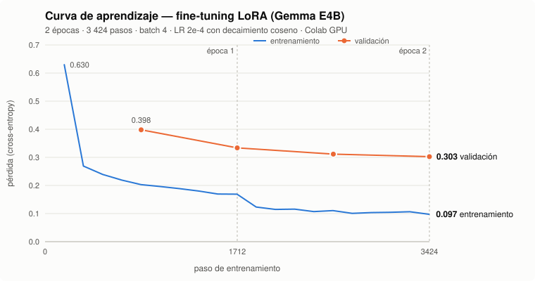

# MUSA-AI 🎼

**Tutor musical con IA en español: un chat que no solo habla de música, la escribe. Partituras reales que se ven, se escuchan y se exportan a MIDI/ABC, generadas por un modelo propio afinado para música.**

> 🔒 Código privado (proyecto en desarrollo activo).
> Demo disponible bajo solicitud · Revisión de código en vivo disponible para procesos de entrevista.
> Contacto: javierkarimandradetalamante@gmail.com

*EN: Spanish-language AI music tutor. FastAPI backend that streams LLM responses over SSE, with Google/Apple OIDC + passwordless email auth, PostgreSQL (SQLAlchemy async + Alembic), a Redis-backed inference queue with health-checked failover across llama.cpp endpoints, Prometheus metrics, and a Rust sidecar for SSRF-safe web search. Gemma E4B fine-tuned with QLoRA (PEFT/TRL/Unsloth), exported to GGUF; self-built, validated 47k-example music dataset for the next training cycle. Deployed with Docker Compose behind Caddy (auto-HTTPS).*

<!-- TODO: GIF del chat generando una partitura que suena con cursor -->

---

## Qué hace

- **Chat con niveles y personalidades**: principiante / intermedio / maestro; instructor, compositor, arreglista, teórico, productor.
- **Partituras de verdad**: la notación que genera el modelo (ABC) se valida, se dibuja en pentagrama, suena con cursor sincronizado y se descarga en MIDI/ABC.
- **Respuestas en streaming** con estados visibles ("analizando", "componiendo"…) y bitácora de cómo se resolvió cada respuesta.
- **Búsqueda web con fuentes** para preguntas que requieren información actual.
- **Cuentas y sincronización** de conversaciones y ajustes entre dispositivos.

## Arquitectura

```text
                     Internet
                        │
                 Caddy (HTTPS automático)
             ┌──────────┴───────────┐
       React (chat)            FastAPI  ── gunicorn, N workers / réplicas
                                  │  SSE
     ┌──────────────┬─────────────┼──────────────┬───────────────┐
 PostgreSQL 16    Redis 7     Pool de inferencia     musa-web (Rust) ── SearXNG
 SQLAlchemy async  cola y      llama.cpp / LM Studio  anti-SSRF, robots.txt,
 + Alembic         slots       / Colab, con failover  caché
                                  │
                       Gemma E4B + LoRA (GGUF)
```

- La API **no sale a internet por su cuenta**: toda búsqueda web pasa por un servicio interno en Rust que aplica protecciones anti-SSRF, respeta `robots.txt` y cachea.
- **Pool de inferencia**: sondeo de salud de varios servidores de modelo, marcado de nodos caídos y reparto entre candidatos sanos. La cola y los slots viven en Redis, así que la API escala horizontalmente sin cambios.
- **Presupuesto de contexto**: estimación de tokens y recorte del historial para no exceder la ventana del modelo.
- Página de estado pública (`ok / degraded / down` con causa) y **modo mantenimiento** activable en caliente.

## Backend — decisiones técnicas

| Área | Implementación |
|---|---|
| API | FastAPI + Pydantic v2, 17 endpoints, incluido el chat en streaming (SSE) |
| Autenticación | Google OpenID Connect (código de autorización + **PKCE**, `state` y `nonce`), **Sign in with Apple** y acceso sin contraseña por código al correo |
| Sesiones | Cookie `HttpOnly`, `SameSite=Lax`, `Secure` en producción; cabecera **anti-CSRF** obligatoria en peticiones que modifican datos |
| Datos | PostgreSQL con SQLAlchemy 2 (async) y migraciones Alembic; usuarios, identidades, sesiones, conversaciones y ajustes |
| Robustez | Rate limiting por usuario, errores con mensajes públicos saneados, límites de tamaño en contexto y perfil |
| Observabilidad | Métricas Prometheus (tokens/s, espera en cola), `/healthz` y `/readyz`, logs JSON con `request_id` propagado en `X-Request-ID` |
| Contrato front/back | Esquema versionado (`musa-ui/1`) para los eventos del stream, con tests de contrato |
| Privacidad | Borrado de cuenta por el propio usuario |
| Despliegue | Docker Compose: Caddy, API, migraciones, Redis, PostgreSQL, servicio Rust, SearXNG y llama.cpp opcional |

## IA y datos

### Entrenamiento

Pipeline de 12 notebooks en Google Colab, de los datos al servidor: preparación de datasets → entrenamiento → exportación a GGUF → versionado → RAG → visión → audio → transcripción → servidor.

- **Técnica**: fine-tuning supervisado (SFT) con **QLoRA**: base Gemma E4B cuantizada a 4 bits (`bitsandbytes`) y adaptador LoRA (`r=64`, `alpha=128`) con `peft` y `trl` (`SFTTrainer`), acelerado con `unsloth`.
- **Exportación**: fusión del adaptador, cuantización `Q4_K_M` a GGUF y servicio con `llama.cpp`, en Colab con GPU, local con LM Studio o en servidor CPU.
- **Preferencias**: pares DPO preparados para una fase de alineación posterior al SFT.



*Ciclo de julio 2026, datos reales de `trainer_state.json`.* La pérdida de entrenamiento bajó de **0.630 a 0.097** y la de validación de **0.398 a 0.303** en 2 épocas. La validación siguió bajando en la segunda época, así que no hubo sobreajuste que la empeorara. La brecha entre las dos curvas creció, y por eso el siguiente ciclo amplía y diversifica el dataset en lugar de entrenar más épocas.

### Dataset propio

- **v7: 47 153 ejemplos** de teoría, armonía, contrapunto, formas, arreglos, oído y tablatura, generados y curados con un pipeline en Python de 25 generadores. Es más de 3 veces el dataset del ciclo anterior y está listo para el siguiente entrenamiento.
- Validación automática de cada partitura (compases y alturas con `music21`), *fact-checking*, control de cobertura y filtro de licencias de las fuentes.
- Versionado con hash y **revisión humana con firma** antes de entrenar, más una herramienta web propia para revisar muestras.

### Evaluación y multimodal

- Baterías de evaluación de partituras y respuestas, con líneas base por versión.
- **RAG** experimental: embeddings con `sentence-transformers` e índice `faiss` sobre un corpus musical, incluida la ingesta de PDFs con OCR.
- **Audio**: datasets sintéticos con `librosa` y `soundfile`; transcripción audio → partitura con `demucs` (separación de fuentes) → `basic-pitch` → MusicXML, y render con `verovio`.

## Calidad

- **~140 tests** de backend (contrato de la UI, autenticación, pool de inferencia…) y **~190 tests** del pipeline de datos.
- Tests E2E del chat en navegador headless.

## Stack

- **Backend:** `Python` · `FastAPI` · `Pydantic` · `SQLAlchemy (async)` · `Alembic` · `PostgreSQL` · `Redis` · `httpx` · `SSE` · `Prometheus` · `gunicorn/uvicorn`
- **Infra:** `Docker Compose` · `Caddy` · `llama.cpp` · `SearXNG` · `Rust` (servicio de búsqueda)
- **IA / ML:** `PyTorch` · `Hugging Face Transformers` · `PEFT (LoRA/QLoRA)` · `TRL` · `Unsloth` · `bitsandbytes` · `Datasets` · `llama.cpp / GGUF` · `sentence-transformers` · `FAISS` · `Google Colab`
- **Audio / música:** `music21` · `librosa` · `Demucs` · `basic-pitch` · `verovio`
- **Frontend:** `React` · `abcjs` · Web Components

## Lo que aprendí

- Diseñar autenticación moderna (OIDC + PKCE, cookies seguras, CSRF) sin depender de un proveedor de identidad pagado.
- Servir un LLM propio con cola, failover y métricas, en vez de llamar a una API de terceros.
- Construir un dataset con la misma disciplina que el código: validación, versionado, tests y revisión antes de cada entrenamiento.

---

**Autor:** Javier Karim Andrade Talamante — Backend Developer · Hermosillo, México
